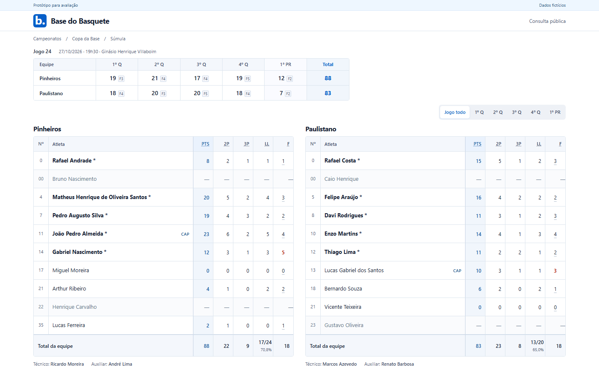
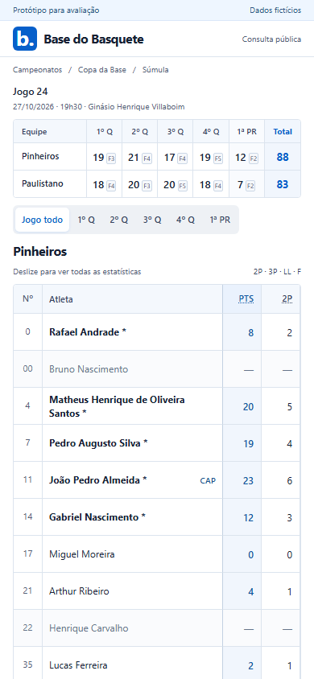
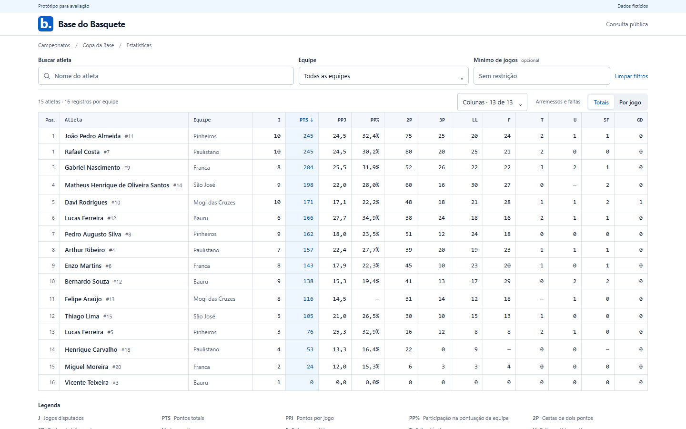

# Validação dos protótipos públicos

Referências locais revisadas em 29/10/2026. Base Git: `4bc93c68c758db4caaa2a77045efb39277a2bc7e`; branch `codex/design-publico`. O SHA final da entrega e sua CI são registrados na PR.

## Primeira informação útil

Medição em Chromium, sem rolagem inicial, com as fontes e os dados fictícios dos protótipos. As capturas mostram a área exata da tela, sem adicionar a altura de uma barra de navegador.

| Página       | Tela     | Primeira linha antes | Primeira linha revisada | Linhas completas visíveis |
| ------------ | -------- | -------------------- | ----------------------- | ------------------------- |
| Súmula       | 1440×900 | 754 px               | 365 px                  | 10 por equipe             |
| Súmula       | 390×844  | —                    | 390 px                  | 9 da primeira equipe      |
| Estatísticas | 1440×900 | 418 px               | 269 px                  | 16                        |
| Estatísticas | 390×844  | 586 px               | 419 px                  | 11                        |

O antes de estatísticas corresponde ao pacote r6 fornecido, renderizado na mesma largura. O antes da súmula foi congelado antes de compactar o cabeçalho. O relatório [hierarquia.json](evidencias/hierarquia.json) registra medidas sem arredondamento e SHA256 dos HTMLs medidos. Não há transbordamento horizontal da página nessas larguras.

| Súmula no desktop                                         | Súmula no celular                                        |
| --------------------------------------------------------- | -------------------------------------------------------- |
|  |  |

| Estatísticas no desktop                                                | Estatísticas no celular                                               |
| ---------------------------------------------------------------------- | --------------------------------------------------------------------- |
|  |  |

## Verificações funcionais

Súmula: 24 grupos gerais e oito de recortes/penalidades aprovados. Incluem coerência entre PTS e convertidos, jogadores/equipe/quartos/placar, tentativas coletivas, cobertura ausente, 0/00, capitão reserva, cinco titulares, quem zerou e quem não entrou. Teclado, toque, Escape, retorno de foco e rolagem com identificação fixa conferidos. Larguras intermediárias de 320 a1440 px sem transbordamento. Axe sem violações automáticas nos estados verificados, incluindo detalhe aberto.

Estatísticas: tipagem sem diagnósticos, cinco testes de regras e o percurso de browser r6 aprovados após a compactação. Confere 16 registros, 15 colunas desktop/11 mobile iniciais, seletor de 13 opções, filtros de equipes, busca/mínimo, médias, empates, ausência, ordenação, estados vazio/carregando, tooltips, teclado, toque, painéis e scroll sincronizado. Axe sem violações automáticas nos estados verificados.

Falhas encontradas e corrigidas: expectativa antiga de um resumo retirado; painel de colunas deslocado para fora da tela após a compactação; formatação de um relatório gerado. Não foram contornadas com cliques forçados ou relaxamento do requisito de visibilidade.

## Limites

Gate local consolidado: `npm run gate` exit0, com 588 testes em120 arquivos, seis de transporte,13 de banco,25 de Worker e prova de quatro PDFs, além de tipos, builds, fronteira e scanner de segredos. Log local `.design-gate.log`, SHA256 `bf2be9541ec31b0d50ffa6ca9b0b6152ed7094280a6b45a8762bbe54828de2cd`. `npm run design:verify` final exit0; log `.design-verification-final.log`, SHA256 `23b20333d247be458b2659fe2f1992893321daeb38c8675e1c201ed96438d2be`. Os logs são diagnósticos locais ignorados. A CI da PR verifica o SHA remoto e executa também os browsers do produto; conferir seu resultado antes de integrar.

Esta evidência se refere aos artefatos e fixtures locais. Não houve integração nas rotas, banco, deploy ou publicação. Não há aceite humano da revisão final nem auditoria completa de acessibilidade, leitor de tela ou dispositivos físicos. Na integração, comprovar a cobertura dos dados por período e penalidade.
