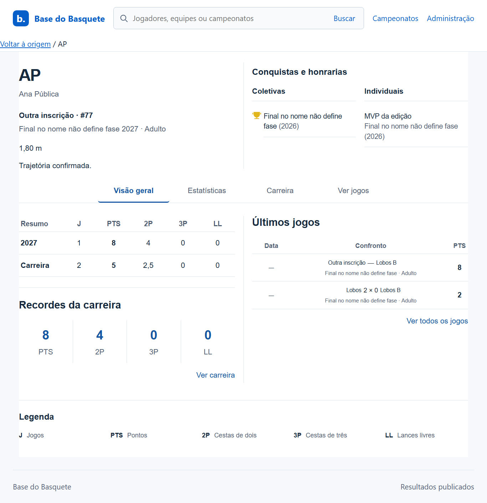
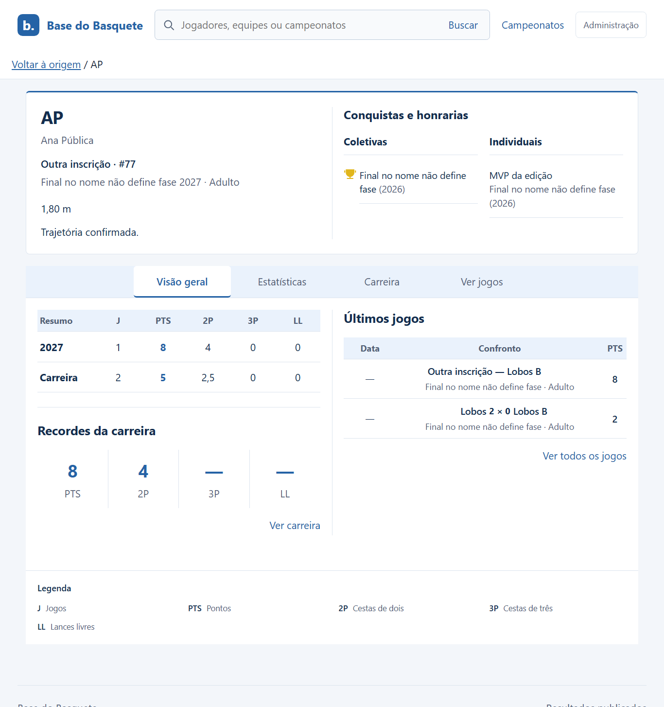
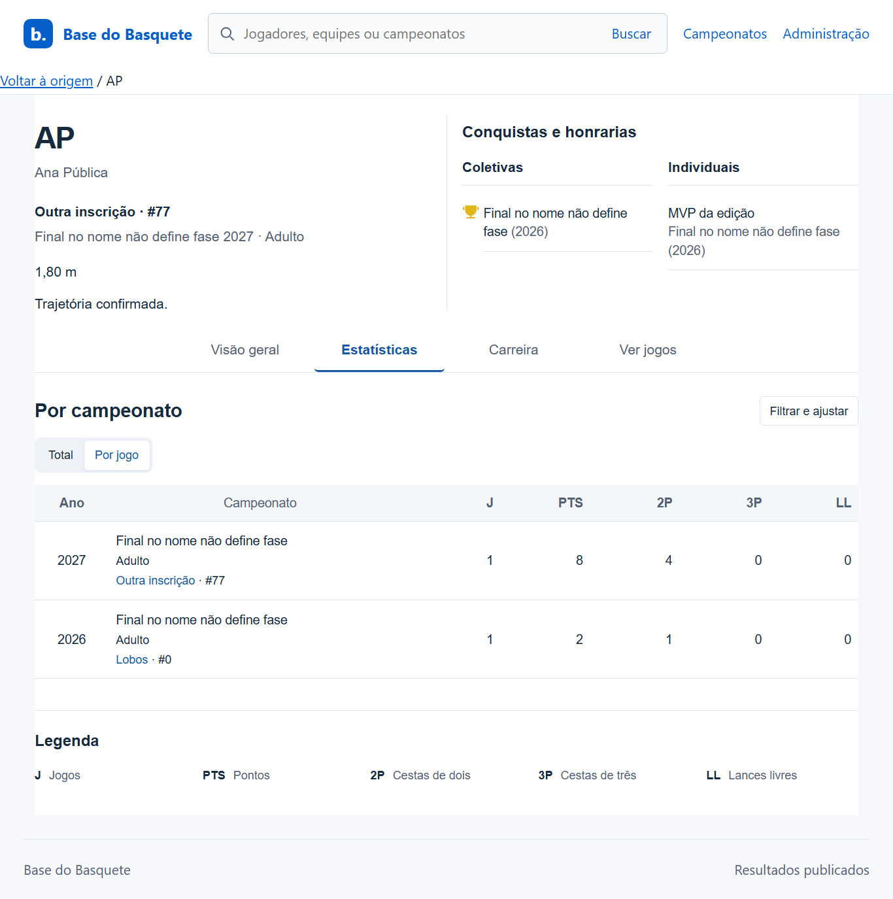
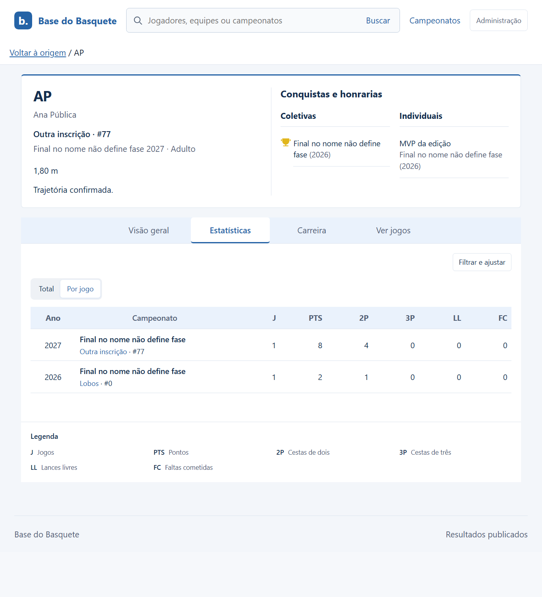
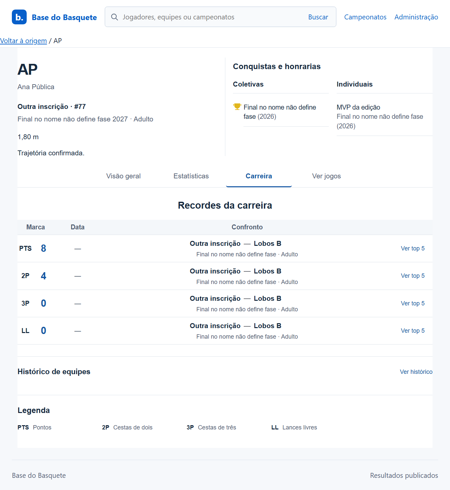
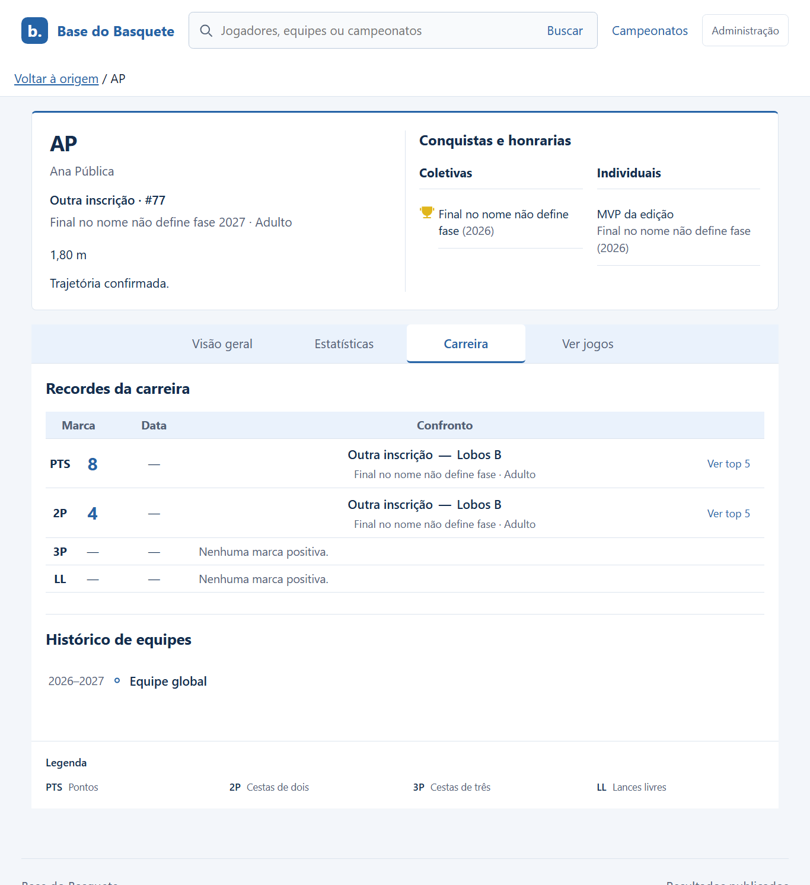
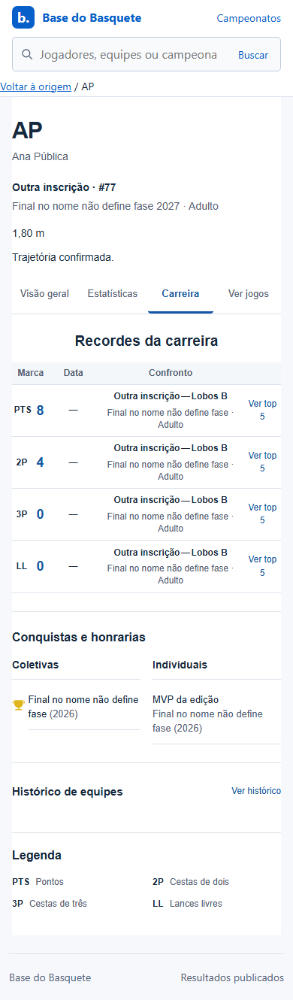
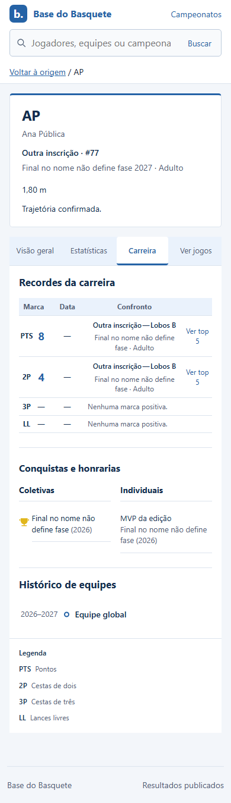

# Refinamento público — antes e depois

Capturas reais com fixtures locais. Antes e depois usam os mesmos dados e larguras. As quatro abas também foram capturadas em 320/390/640/1366/1920 no conjunto local de evidências. A comparação abaixo seleciona os percursos mais representativos.

## Visão geral — desktop1366

| Antes                                       | Depois                                        |
| ------------------------------------------- | --------------------------------------------- |
|  |  |

Identificação e conteúdo se distinguem do fundo; cabeçalhos e abas recebem azul suave. A legenda acompanha a escala compartilhada de Jogadores e Equipes. Marcas sem valor positivo deixam de receber destaque numérico.

## Estatísticas — desktop1366

| Antes                                              | Depois                                               |
| -------------------------------------------------- | ---------------------------------------------------- |
|  |  |

Categoria passa para a linha do campeonato; Adulto é omitido nessa célula. Nome da equipe e camisa permanecem abaixo. FC integra o padrão. O título interno redundante foi removido.

## Carreira — desktop1366 e mobile390

| Antes                                              | Depois                                               |
| -------------------------------------------------- | ---------------------------------------------------- |
|  |  |
|    |    |

Histórico sempre aberto, com anos, círculos e conexões preservados. Recordes inteiramente zerados recebem estado vazio. No desktop, conteúdo curto compartilha uma reserva de altura limitada; no celular, a página segue a altura natural.

## Componentes compartilhados — depois

| Página         | Desktop1366                               | Mobile390                                |
| -------------- | ----------------------------------------- | ---------------------------------------- |
| Jogadores      | [Captura](depois-1366-jogadores.png)      | [Captura](depois-390-jogadores.png)      |
| Equipes        | [Captura](depois-1366-equipes.png)        | [Captura](depois-390-equipes.png)        |
| Busca          | [Captura](depois-1366-busca.png)          | [Captura](depois-390-busca.png)          |
| Jogos públicos | [Captura](depois-1366-jogos-publicos.png) | [Captura](depois-390-jogos-publicos.png) |

O apelido aparece como complemento, sem prefixo. Cabeçalhos/contextos usam os tokens públicos; placares ausentes e conhecidos ficam distintos. Tipografia das legendas foi comparada por estilo computado nas três páginas. As capturas de Jogos públicos incluem a longa lista usada para testar equipes com nomes extensos, agenda ausente e W.O.

[Resultados, comandos e limites](../../../VALIDACAO-REFINAMENTO-PUBLICO.md). As imagens não comprovam conformidade integral à WCAG nem substituem aceite visual.
