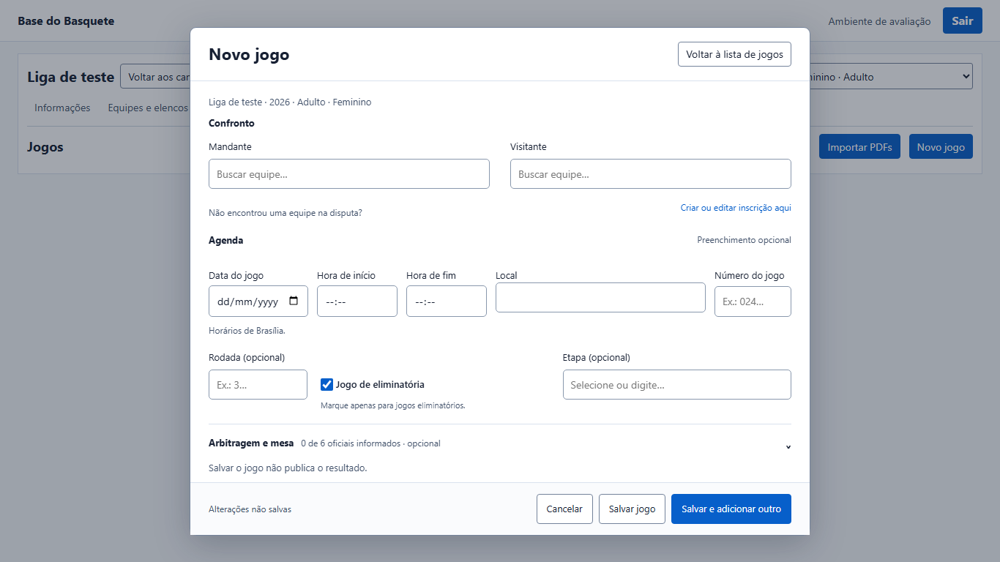
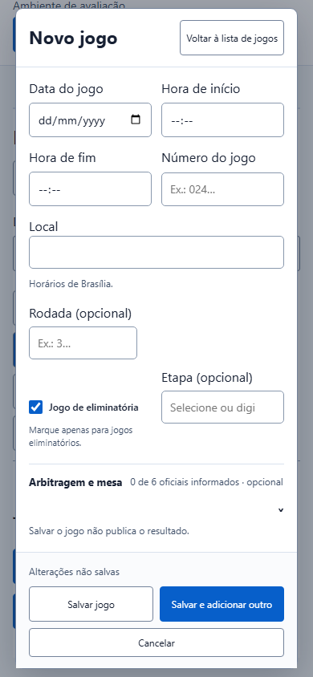

# Cadastro administrativo de jogos — PR #49

Protótipo aprovado nesta conversa, implementado na mesma branch `codex/navegacao-publica`. Código `7e5b1fc93ab6814a6799676661b53632ca9e0cf5`; base deste incremento `ad15231ec3d9cdb54964785023f3b76338582f7f`.

## Resultado

- Mandante e Visitante com busca independente, paginação, limpeza e teclado; Escape conserva a seleção. A busca separada foi substituída; cadastro contextual e retorno preservados.
- Agenda com data, início, fim, local e número, reutilizando persistência e virada do dia existentes. Jogos encerrados conservam agenda protegida e correção de horários reais.
- Rodada numérica opcional com sugestões da disputa. Eliminatória desmarcada por padrão; Etapa opcional abre à direita, inclusive em 320 CSS px, com sugestões e nomes livres.
- Arbitragem recolhível e ações fora da rolagem. Salvar e adicionar outro mantém somente data/local/rodada. Recuperação conserva comando e intenção após envio incerto ou ACK seguido de leitura falha.
- Novos dados administrativos: não cria grupos/séries, nem altera regulamento, projeções ou estatísticas públicas.

## Persistência

Migration nova `20261103163618_game_editor_metadata.sql`, criada com Supabase CLI e testada apenas em PGlite descartável. Acrescenta `stage_kind`, `round_number`, `knockout_stage` e RPC autenticada de rodadas com security invoker. RLS/permissões existentes preservadas. Jogos antigos recebem regular por decisão explícita do responsável; envios antigos preservam os campos omitidos e os recibos existentes.

Sem aplicação remota, DML humano, deploy ou merge. A migration anterior de estatísticas coletivas também permanece pendente.

## Validação

Windows, Node 24.18.0, Chromium headless, fixtures sintéticas, código `7e5b1fc`.

- Banco: **2 PASS**, instalação nova e atualização, compatibilidade, idempotência, limites, etapas inválidas, isolamento por disputa e permissões.
- Playwright final, nove arquivos de jogos/arbitragem/locais/PDFs/retornos/admin/súmula legada, dois workers: **99 PASS / 31 SKIP** dos recortes existentes. Inclui 1366×768, 1920×1080, 390/320 px, zoom equivalente em 683×384, axe, foco, erros e recuperação sem duplicação.
- Gate com `VITEST_MAX_WORKERS=2`: em execução neste checkpoint; lint/formato/tipos aprovados. Conferir o resultado consolidado em `.preview-artifacts/game-editor-gate.log` antes de declarar PASS.
- Falhas exploratórias de expectativas antigas, alinhamento, legenda oculta e ícone de limpar foram corrigidas. Uma rodada posterior sofreu `ENOSPC` no C:; regressão final passou usando TEMP/TMP e resultados em `Y:/Codex-Temp/pr49-jogos-20261103`. Nenhum arquivo alheio foi removido.
- Revisão local com `ui-ux-pro-max` e fonte atual de `web-design-guidelines`, sem alegação de revisão independente, piloto remoto ou conformidade WCAG integral.

Mesma [PR #49](https://github.com/renato-lucindo/base-do-basquete-next/pull/49), mantida draft; [CI do HEAD](https://github.com/renato-lucindo/base-do-basquete-next/pull/49/checks). Migrations e deploy exigem autorização específica.
