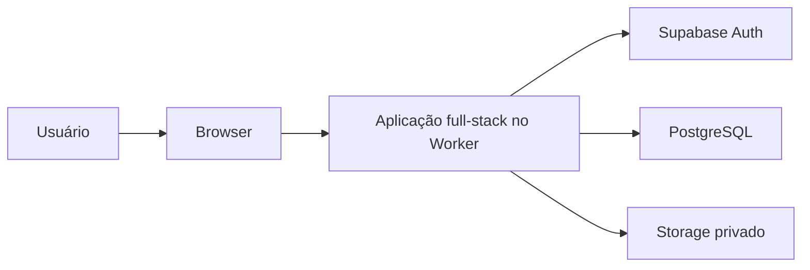

# Arquitetura de software

## Estilo e responsabilidades

Monólito modular full-stack, TypeScript estrito, publicado em Cloudflare Workers. Módulos de negócio com interfaces explícitas e baixo acoplamento: competições/regulamento, participantes, jogos/súmula, importação, estatísticas, publicação e acesso. São fronteiras de responsabilidade; não exigem serviço, pacote ou camada vazia por entidade.

Dentro de cada módulo, distinguir:

| Responsabilidade | Conteúdo | Dependências permitidas |
| --- | --- | --- |
| Domínio | Fórmulas, invariantes, regras e tipos de negócio | Código de domínio; sem framework web, SDK de banco ou HTTP |
| Aplicação | Casos de uso, autorização contextual, coordenação e fronteiras transacionais | Domínio e contratos das integrações necessárias |
| Infraestrutura | Persistência, queries SQL, Auth, Storage, extração e serviços externos | Implementa contratos e traduz formatos externos |
| Apresentação | Páginas, controles, estados e entrada do usuário | DTOs públicos e chamadas aos casos de uso |

As dependências de implementação apontam para contratos e domínio. A composição no servidor conecta adaptadores reais. Não importar SDK Supabase no domínio puro nem no browser. Não criar um repositório por tabela, uma interface para cada função ou um contêiner de injeção sem necessidade concreta.

Uma ação de tela pode coordenar várias entidades; a divisão do banco não exige uma sequência de páginas. Módulos não devem escrever indiscriminadamente nos dados uns dos outros: coordenar por casos de uso e transações explícitas.

## Contexto e execução

Esse desenho apresenta as fronteiras de confiança; detalhes internos permanecem na implementação. Documentar o contexto e os componentes relevantes com o nível de detalhe necessário. C4 é uma referência de representação, não uma obrigação de gerar quatro diagramas para toda mudança.

## Banco novo: modelo lógico

Criar projeto Supabase independente; banco e Storage inicialmente vazios. Sem importar migrations, catálogos completos ou dados de produção de outro ambiente. O implementador define nomes físicos, tipos de IDs e índices coerentes, documentando decisões relevantes. O modelo precisa representar:

| Área | Entidades e relações |
| --- | --- |
| Contexto | Campeonato recorrente → temporada → disputas por naipe, categoria e divisão opcional |
| Organização | Regulamentos versionados, fases, grupos, confrontos/séries, classificação e decisões administrativas |
| Pessoas/equipes | Identidades globais de atletas e equipes; perfil público separado do privado |
| Inscrições | Participação da equipe na disputa, com nome público próprio; múltiplas inscrições da mesma equipe |
| Vínculos | Atleta, inscrição, camisa e vigência; transferência e retorno sem reatribuição retroativa de jogos |
| Partidas | Duas inscrições, agenda, estado, relacionados, camisa da ocasião, participação, placar e períodos reais |
| Fontes | Documento/submissão, formato, versão, hash, validação e capacidades por domínio de dados |
| Fatos | Pontos, arremessos, tempo em segundos, rebotes, assistências, erros, roubos, tocos, faltas e dados coletivos realmente informados |
| Publicação | Rascunho, versão pública, revisão e fonte autoritativa; snapshots/derivados consistentes |
| Resultados | Colocações, honrarias, regras de desistência e efeitos administrativos distintos de fatos estatísticos |
| Operação | Pedidos idempotentes, controle de versão e auditoria essencial |

Dados de entrada são fatos; totais, médias, percentuais, eficiência, classificação e líderes são derivados. Materializar derivados somente com origem, versão e invalidação definidas. O contrato matemático e seus casos de teste devem ser comuns às implementações SQL/TypeScript; evitar duas fórmulas divergentes para a mesma métrica.

## Integridade

Definir PKs/FKs, constraints, nulabilidade e índices conforme as relações e consultas. Nome não é chave única de atleta. Camisa é string: 0 e 00 são diferentes. Um atleta tem no máximo um vínculo ativo por disputa; histórico precisa suportar transferência e retorno. Resultados são atribuídos à identidade e inscrição do jogo, nunca à equipe atual por aproximação.

Inteiros não negativos para contagens e tempo; saldo em quadra admite negativos. Não usar zero como substituto de informação ausente. Estado de participação distingue jogou, não jogou e informação desconhecida conforme a fonte. Ausência de placar não significa 0 a 0. Períodos só representam períodos reais, não um bucket de total de jogo.

## Transações e publicação

Casos de uso de gravação validam ator, contexto, entrada e versão no servidor. Operações críticas revalidam integridade no PostgreSQL. Confirmar e publicar tem atomicidade por jogo, com resultado individual no lote. Uma falha não deve deixar uma publicação parcial aparente nem desfazer os outros jogos concluídos.

Salvar rascunho não publica. Correção gera revisão e republicação consistente; nenhuma operação expõe rascunhos de outros jogos. Chave idempotente identifica uma intenção: replay idêntico repete resultado; reutilização com conteúdo diferente é rejeitada. Conflito de versão exige recarga explícita; não atualizar o token da cópia desatualizada para forçar nova tentativa.

## Segurança e evolução de acesso

Uma conta administrativa por senha, sem MFA obrigatório inicialmente. Autenticação não equivale a autorização: outra conta autenticada permanece sem acesso. Centralizar política por ator, ação e recurso; resolver campeonato/temporada/disputa no servidor. Preparar consultas e arquivos para futura limitação por campeonato e função sem implementar agora gestão de papéis/convites.

RLS desde a criação nas tabelas expostas; grants, views, EXECUTE e contexto das funções revisados. Não usar user_metadata editável para autorizar. Funções privilegiadas exigem finalidade delimitada, search_path seguro e autorização interna. Não usar credencial genérica para contornar todas as permissões.

Backend autoritativo; frontend não inicializa SDK de banco/Supabase. Projeções públicas contêm somente dados publicados e campos públicos. Sexo, nascimento completo e registro federativo não aparecem em HTML, JSON, preloads ou logs públicos. Sessão segura, proteção de origem/CSRF, validação e limitação de abuso nas operações apropriadas.

Storage privado, arquivos autorizados por recurso e finalidade; validar assinatura, tamanho, formato e páginas do PDF. Segredos nos cofres dos ambientes, nunca em Git, browser, evidências ou mensagens. Usar ambientes de desenvolvimento/teste separados da produção.

## Evolução e documentação

Migrations próprias versionadas desde a primeira versão, com criação do zero e upgrades verificados. Gerar tipos a partir do novo schema e manter domínio independente desses tipos de infraestrutura. APIs/DTOs expressam a necessidade da tarefa e não reproduzem tabelas automaticamente.

README explica instalação, execução, testes e configuração por nomes de variáveis. Issues/PRs registram trabalho, revisão e evidências. ADRs curtos registram decisões significativas: contexto, decisão, estado e consequências. Não exigir ADR por ajuste rotineiro. Detalhar endpoints em contrato de API quando existirem, sem inventar rotas obrigatórias no kit.

Referências: [C4](https://c4model.com/), [ADRs — Michael Nygard](https://www.cognitect.com/blog/2011/11/15/documenting-architecture-decisions), [migrations Supabase](https://supabase.com/docs/guides/deployment/database-migrations), [RLS](https://supabase.com/docs/guides/database/postgres/row-level-security).
